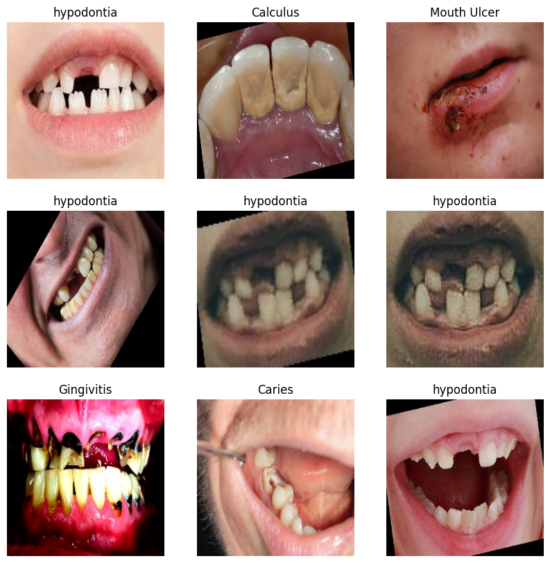
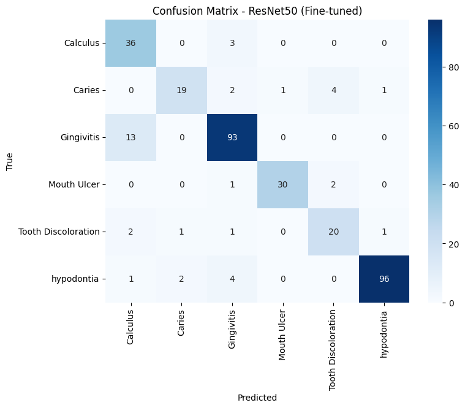

# 🦷 Oral Disease Image Classification

An end-to-end deep learning project that classifies intraoral photos into six oral
conditions, compares multiple modeling approaches, and ships the best model behind
a FastAPI web app.


---

## Table of Contents

- [Overview](#overview)
- [Dataset](#dataset)
- [Project Pipeline](#project-pipeline)
- [Data Cleaning](#data-cleaning)
- [Models](#models)
- [Results](#results)
- [Deployment](#deployment)
- [Project Structure](#project-structure)
- [Running Locally](#running-locally)
- [Running with Docker](#running-with-docker)
- [Tech Stack](#tech-stack)
- [Limitations](#limitations)

---

## Overview

This project was built as part of the Instant Academy AI & Data Science track.
The objective: build, compare, and deploy an AI system that classifies oral
disease images into their correct categories.

**Classes (6):** Calculus · Caries · Gingivitis · Mouth Ulcer · Tooth Discoloration · hypodontia

**Requirements covered:**
- ✅ Custom CNN built from scratch
- ✅ 3 pretrained models (EfficientNetB2, ResNet50, MobileNetV2)
- ✅ Fine-tuning of the best-performing model
- ✅ Hyperparameter tuning
- ✅ Comparative analysis across all models
- ✅ Deployment app (FastAPI + web frontend)

---

## Dataset

Source: [Oral Diseases Dataset](https://www.kaggle.com/datasets/salmansajid05/oral-diseases) (Kaggle)



The raw dataset ships with original images, pre-augmented copies, and a
YOLO-annotated subset per class. Only the **original images** were used for
training to avoid data leakage; augmented and YOLO folders were excluded from
the splitting stage.

---

## Project Pipeline

1. **Data Cleaning** — remove exact and near-duplicate images, drop cross-class label conflicts
2. **Stratified Split** — 70% train / 15% validation / 15% test
3. **Data Loading** — `image_dataset_from_directory` with caching and prefetching
4. **Custom CNN** — baseline model trained from scratch
5. **Transfer Learning** — EfficientNetB2, ResNet50, MobileNetV2 (frozen base)
6. **Fine-Tuning** — unfroze the top layers of the best model (ResNet50) for further gains
7. **Comparative Analysis** — per-class F1 and accuracy across all 5 models
8. **Deployment** — FastAPI backend + web frontend, containerized with Docker

---

## Data Cleaning

The raw dataset had two issues that directly affect model reliability:

- **Exact duplicates**: identical images (by hash) copied into multiple class
  folders — kept once, and removed entirely from any class where it caused a
  label conflict.
- **Near-duplicates**: resized/recompressed/flipped copies of the same photo,
  detected with perceptual hashing (`imagehash`), grouped, and reduced to one
  representative per group — this prevents the same patient's photo from
  appearing in both the training and test sets.

After cleaning, the dataset was **split before any augmentation** to guarantee
zero leakage between train / validation / test, verified with an exact-hash
and near-duplicate audit across all three splits.

---

## Models

| # | Model | Approach |
|---|---|---|
| 1 | Custom CNN | Built from scratch — 4 conv blocks, BatchNorm, GlobalAveragePooling, Dropout |
| 2 | EfficientNetB2 | Transfer learning, frozen base |
| 3 | ResNet50 | Transfer learning, frozen base |
| 4 | MobileNetV2 | Transfer learning, frozen base |
| 5 | **ResNet50 (fine-tuned)** | Top 60 layers unfrozen, trained with a low learning rate |

All models share the same augmentation pipeline (rotation, translation,
horizontal flip, contrast) and were trained with **class weights** to handle
the dataset's class imbalance, plus `EarlyStopping`, `ReduceLROnPlateau`, and
`ModelCheckpoint` callbacks.

---

## Results



| Model | Test Accuracy |
|---|---|
| **ResNet50 (fine-tuned)** | **88.3%** |
| EfficientNetB2 | 79.6% |
| ResNet50 (frozen) | 77.5% |
| MobileNetV2 | 76.9% |
| Custom CNN | 71.5% |

**ResNet50 (fine-tuned)** was selected as the final model. Unfreezing the top
60 layers and continuing training with a low learning rate (1e-5) let it adapt
pretrained ImageNet features to the domain-specific textures of oral disease
images.

### Training Curves (Best Model)

_training_history_curves.png)

### Confusion Matrix (Best Model)

_CM.png)

The most common error across **every** model tested was confusing
**Calculus** and **Gingivitis** — this is consistent with real visual overlap
between the two conditions (calculus buildup frequently co-occurs with
gingival inflammation) rather than a model-specific weakness.

---

## Deployment

The best model is served through a **FastAPI** backend with a clean separation
of concerns:

- `model_service.py` — loads and runs the model (singleton, loaded once at startup)
- `preprocessing.py` — validates and prepares uploaded images
- `schemas.py` — request/response validation with Pydantic
- `main.py` — routes only, no business logic
- A lightweight HTML/CSS/JS frontend for drag-and-drop image upload and
  live predictions

### API Endpoints

| Method | Path | Description |
|---|---|---|
| `GET` | `/` | Web frontend |
| `GET` | `/health` | Health check |
| `POST` | `/predict` | Upload an image, get a prediction |

---

## Project Structure

oral-disease-classification/
├── project_notebook.ipynb # full training pipeline
├── assets/ # result visuals used in this README
├── deployment/
│ ├── app/
│ │ ├── main.py
│ │ ├── config.py
│ │ ├── model_service.py
│ │ ├── preprocessing.py
│ │ ├── schemas.py
│ │ ├── exceptions.py
│ │ └── static/ # frontend (HTML/CSS/JS)
│ ├── models/ # exported model + class names
│ ├── tests/
│ ├── Dockerfile
│ └── requirements.txt
└── README.md


---

## Running Locally

```bash
cd deployment
pip install -r requirements.txt
uvicorn app.main:app --reload
```

Open `http://127.0.0.1:8000` for the web app, or `http://127.0.0.1:8000/docs`
for the interactive API docs.

## Running with Docker

```bash
cd deployment
docker build -t oral-disease-api .
docker run -p 8000:8000 oral-disease-api
```

Open `http://localhost:8000`.

---

## Tech Stack

- **Modeling:** TensorFlow / Keras, scikit-learn, imagehash
- **Backend:** FastAPI, Pydantic, Uvicorn
- **Frontend:** HTML, CSS, vanilla JavaScript
- **Deployment:** Docker
- **Data:** Kaggle (`salmansajid05/oral-diseases`), downloaded via `kagglehub`

---

## Limitations

- Several classes (Caries, Tooth Discoloration) have a small number of
  original images after cleaning, which limits the reliability of their
  test-set metrics.
- Calculus and Gingivitis remain hard to separate across all models tested,
  likely due to genuine visual overlap in the underlying condition rather
  than a model limitation.
- The model is trained for educational purposes and is **not a diagnostic
  tool**.

---

## Author

**Ahmed Tarek**
[GitHub](https://github.com/Ahmed-Tarek0)